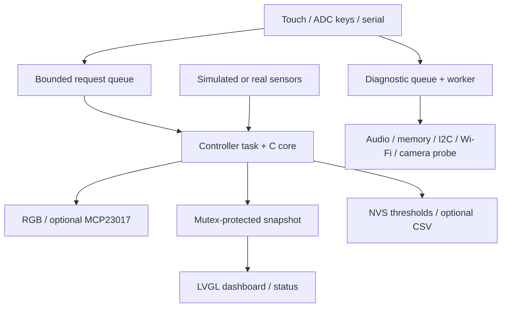

# 软件设计 / Software design

`home_core` 是可在 PC 上编译的纯 C 模块，不依赖 FreeRTOS 或乐鑫驱动。新增 UI/网络入口时不用改写阈值算法。

The portable C core owns state and rules, independent of FreeRTOS and ESP-IDF drivers. New input surfaces reuse the same actions.

## 任务与所有权 / Tasks and ownership

| 执行环境 / Context | 负责 / Responsibility | 约束 / Constraint |
| --- | --- | --- |
| `app_main` | 创建服务、BSP、UI 与串口 / Startup | 先建队列再注册回调 / Queues precede callbacks |
| `home_control`, priority 5 | 唯一修改控制状态、应用输出 / Sole state writer | 50ms 队列等待；约 1s 采样 / Bounded queue + low-rate I/O |
| BSP LVGL task | UI 回调与 500ms 刷新 / UI callbacks, refresh | 回调只投递命令；跨线程 LVGL 用 BSP 锁 / No slow I/O in callbacks |
| BSP button task | 消抖后的短按事件 / Debounced key events | 零等待投递队列 / Non-blocking submission |
| Console REPL | 参数检查、投递、打印快照 / Parse, submit, inspect | `Queued` 不是执行完成 / Acknowledgement is not completion |
| `home_selftest`, priority 3 | 串行执行按需自检 / Serial diagnostics | 最多 2 个等待项 / Bounded backlog |

传感器读写、BSP 触摸和 codec 控制共享同一个 I2C bus handle。IDF 驱动保护单次总线事务；应用不从回调里重新初始化总线。音频读写、自检日志状态不会持有控制快照锁。共享快照只在内存复制时短暂加锁。

I2C clients share the BSP bus; no second bus is created on the same pins. Snapshot locks cover only memory copies. Audio and diagnostic work does not run while holding the state snapshot lock.

控制任务仍有最多数百毫秒传感器转换等待和可能更慢的 SD 写入，本版目标是便于理解的低速原型，不承诺硬实时延迟。若实测需要，按 ROADMAP 拆分采集/日志；保留核心的单写者状态模型。

The controller includes sensor conversion delays and optional card writes. It is an educational low-rate prototype, with no hard real-time guarantee. Split acquisition/storage workers only when measurements justify it.

## 控制规则 / Rules

| 规则 / Rule | ON | OFF | 中间区间 / Between |
| --- | --- | --- | --- |
| 风扇 / Fan | 温度 ≥28°C | 温度 ≤26°C | 保持 / Preserve |
| 灯光 / Light | 照度 ≤100lux | 照度 ≥200lux | 保持 / Preserve |

湿度只显示/记录，不控制负载。阈值可修改；要求 fan_off < fan_on、light_on < light_off，拒绝 NaN/Inf 和非法范围。环境采集失败立即标记对应数据无效，不使用虚假 0 或自动切换回模拟数据。距最近样本 **≥5000ms**、时间戳异常、读数无效时，相应 AUTO 输出 OFF。温度、湿度、光照分别报告有效性。

Humidity is display/log only. Invalid ranges, NaN/Inf and inverted thresholds are rejected. Read errors are invalid data, not zero measurements or automatic simulation fallback. At sample age **≥5000ms**, or on invalid/future-timestamped data, the affected AUTO output is OFF.

手动灯/风扇命令将整个控制器切换到 MANUAL；其他输出保留原状态。回到 AUTO 后下一轮按有效数据和滞回重新计算。重启：阈值从有效 NVS 配置恢复；输出初始 OFF；默认进入 AUTO，首次有效样本可以改变输出。

A manual load command switches the controller to MANUAL and preserves the other load. AUTO resumes rules on the next iteration. Reboot restores only valid thresholds, initializes outputs OFF, then resumes AUTO after the first valid sample.

## 参数和日志 / Settings and logs

- NVS 命名空间 `home`，键 `config_v1`。固定结构长度与数值验证，不在每次采样时写 Flash。Only explicit `home save` writes thresholds.
- NVS 初始化失败不自动擦除：使用默认参数，保存操作会报告实际错误。Existing NVS is preserved on initialization failures.
- CSV 使用 uptime_ms 而非伪造日期，记录模拟标识、有效性、命令状态。Uptime is not wall-clock time.
- SD 写入失败停止本次会话日志；控制逻辑继续。Card removal is not hot-swap managed.
- 队列容量 16，满时丢弃并计数；自检队列容量 2。No unbounded request backlog.

## 加新功能 / Extension points

新增传感器：`sensors.c → home_sample_t → home_accept_sample()`；新增输入：构造 `home_request_t` 并用 `home_submit()`；新增输出：`board_io.c`；新增自检：`diagnostics.c`。不要从 Web/UI 回调直接改 `home_state_t`。

Add sensors through `home_sample_t`, inputs through `home_submit`, outputs through `board_io`, and diagnostics through the worker. Do not mutate controller state from UI/network callbacks.
