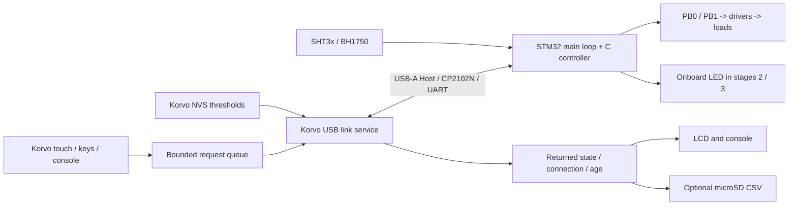

# 软件设计 / Software design

USB 接收队列保存回调的真实接收时间。服务处理延迟不会重置样本/链路年龄；排队已满 3 秒的帧丢弃，超过 1.5 秒请求期限才处理的 ACK 不完成旧请求。界面读取快照时再次计算年龄，避免慢 SD/NVS 操作让旧数据重新显示为正常。官方支持范围及证据等级见 [SUPPORT_EVIDENCE](SUPPORT_EVIDENCE.md)。

本工程只有一个真实控制器：**STM32**。Korvo 负责操作请求、显示与参数持久化；它不会根据收到的读数再次执行自动规则，也不会直接驱动外接负载。明确选择的模拟构建独立使用纯 C 控制器，页面始终标记 SIMULATION。

**STM32 is the sole real controller.** Korvo submits requests, displays returned state and persists thresholds. It does not independently recalculate real outputs. An explicitly selected simulation build uses the portable controller locally and remains labelled SIMULATION.

## 状态归属 / Ownership

| 数据 / State | 权威来源 / Owner | 使用方式 / Use |
| --- | --- | --- |
| 当前温湿度/光照、有效位、样本年龄 / Samples, validity, age | STM32 | Korvo 只显示并追加本地接收后的时间 / Display and account for receive-time ageing |
| 自动/手动模式 / AUTO or MANUAL | STM32 | 请求后等应答；不能点击即视为已切换 / Wait for response |
| 灯/风扇 GPIO 输出状态 / GPIO output state | STM32 | 返回结果，不是电流/转速反馈 / Returned state, not physical feedback |
| 待处理操作、超时、拒绝 / Pending request, timeout, rejection | Korvo | 与返回状态分别呈现 / Separate from returned output state |
| 阈值持久副本 / Persistent thresholds | Korvo NVS | 显式保存；不会被 STM32 的旧值覆盖 / Explicit save, no reverse overwrite |
| 阈值运行副本 / Runtime thresholds | STM32 | 仅接收当前会话有效 CONFIG / Accept validated configuration for current session |
| 真实负载动作 / Physical action | 外部观测 / External observation | 验收时目视记录；当前无电流/转速采集 / No current or speed feedback fitted |

UI/按键回调只投递请求；队列满报告失败。服务处理出站请求和入站状态，并发布短锁保护的快照；LCD/串口/SD 读取快照。不要在 UI 回调中做阻塞 USB/I2C/SD 操作或直接修改返回状态。

UI/key callbacks only enqueue requests. The service processes requests and incoming state, then publishes a snapshot protected during memory copies. A full queue reports rejection. Callbacks do not perform blocking USB/I2C/storage work or directly change reported state.

## 上电、同步与重连 / Boot, synchronization and reconnect

1. Korvo 从 NVS 读取有效阈值；结构、长度或数值不合法时使用默认值。NVS 初始化/写入失败不自动擦除用户数据。STM32 初始化演示负载为 OFF，未同步时拒绝操作。
2. USB 枚举成功后 Korvo 产生新会话，发送 HELLO；STM32 READY 返回阶段。旧会话消息不能改变当前状态。
3. Korvo 发送当前阈值 CONFIG。只有对应成功应答后，链路才允许模式/负载请求。同步失败/超时显示未同步，不假定参数已生效。
4. 已同步状态每秒交换心跳/遥测。一次操作对应序号和结果；SET 明确指定开或关，不使用线上 toggle。
5. 断线清除待处理操作；重连建立新会话重新同步阈值，不重放旧灯/风扇请求，不用旧遥测把请求标为成功。命令应答等待约 1.5 秒；超时表示结果未知，并建立新会话同步。MANUAL 下 STM32 收到新会话 HELLO 立即关闭两路，避免单向返回链路故障时旧开命令被反复握手续租；AUTO 仍执行有效本地数据规则。

Korvo loads validated NVS settings or defaults. STM32 starts with outputs OFF and rejects operations until synchronization. Every connection establishes a fresh session, followed by READY and acknowledged CONFIG before controls are enabled. Commands use sequence numbers and explicit SET values. Disconnect drops pending operations; reconnect synchronizes thresholds without replaying manual actions. STM32 settings never replace Korvo's authoritative copy.

`home thresholds` 修改 Korvo 当前副本并安排同步；`home save` 才写 NVS。未保存的阈值在当前 Korvo 运行期间重连仍下发；Korvo 断电后恢复最近一次成功保存值。STM32 重新上电后运行时副本丢失，必须重新同步。模式/输出不存入 NVS；真实输出以 STM32 返回为准。

Threshold edits update Korvo's current copy and are synchronized. Only explicit save persists them. Reconnect retains unsaved values while Korvo stays powered; a Korvo restart restores the last successful save. STM32 reboot loses its runtime copy and requires synchronization. Mode/output state is not persisted in Korvo.

## STM32 调度与控制 / STM32 scheduling and rules

STM32 使用主循环、毫秒计时和 UART 接收中断，不强制加入 RTOS。内部 HSI 8 MHz，保持对未知学习板外部晶振的独立性。I2C 操作有超时；SHT3x 校验 CRC，BH1750 按其模式换算照度。失败返回无效位，不制造正常的 0 值，不补入模拟数据。真实驱动、启动文件、向量表和链接脚本随工程提供。

STM32 uses a main loop, millisecond scheduling and a UART receive interrupt. It uses internal 8 MHz HSI. I2C operations are bounded; SHT3x CRC is checked, and BH1750 data is converted for its measurement mode. Failures invalidate a channel rather than inventing normal zero readings or simulation. Startup, vectors, linker script and actual drivers are part of the project.

| 自动规则 / AUTO rule | ON | OFF | 滞回区 / Between |
| --- | --- | --- | --- |
| 风扇 / Fan | 温度 ≥28°C | 温度 ≤26°C | 保持输出 / Hold |
| 灯 / Lamp | 照度 ≤100 lux | 照度 ≥200 lux | 保持输出 / Hold |

阈值可修改。湿度只显示。手动 SET 将整个控制器切到 MANUAL，保留另一输出；AUTO 恢复后按有效数据执行规则。测试/传感器 LED 阶段不驱动 PB0/PB1；风扇请求返回不支持，风扇状态始终 OFF。阶段 1 无环境读数、无输出。

Thresholds are editable; humidity is display-only. Manual SET selects MANUAL for the whole controller and preserves the other output. AUTO resumes local rules. LED-only stages do not drive PB0/PB1; fan requests return unsupported and fan state stays OFF. Stage 1 has no measurements or outputs.

## 故障与超时 / Faults and timeouts

| 情况 / Condition | STM32 | Korvo |
| --- | --- | --- |
| 单传感器失败 / One sensor fails | 对应有效位清除；AUTO 对应负载 OFF / Invalidate channel; corresponding AUTO load OFF | 显示对应 FAULT / Channel fault |
| 样本年龄 ≥阈值，默认 5000ms / Stale sample | AUTO 对应负载 OFF / Affected load OFF | 旧值标记过期，不能显示 OK / Mark old data stale |
| 无有效链路活动，MANUAL / Lost link in MANUAL | 约 5000ms 后关闭；新会话 HELLO 可提前关闭 / OFF after about 5 s, earlier on fresh HELLO | USB 事件或约 3000ms 后断开 / USB event or about 3 s timeout |
| 无有效链路活动，AUTO / Lost link in AUTO | 继续使用本地有效数据 / Continue valid local rules | 断开后输出不再视为实时状态 / Output display is no longer live |
| 半帧、溢出或非法字段 / Partial, long or malformed frame | 丢弃，不修改控制状态 / Discard without mutation | 不把非法消息当应答 / Never accept as acknowledgement |
| USB 拔出 / USB unplug | UART 超时策略 / UART timeout policy | 立即或检测超时后断开；不切模拟 / Disconnect, no simulation fallback |
| SD/NVS 失败 / SD or NVS failure | 不受日志任务控制 / Local control independent | 报告实际错误，控制继续 / Report real error, continue control |

通信在线和数据新鲜是不同状态。可收到心跳但没有有效环境数据；也可 STM32 正常运行而 Korvo 已失联。Korvo 只依据返回样本年龄与本地经过时间判断显示有效性，不能因为收到旧数据就重新把它变新。

Link health and sample freshness are separate. Heartbeat may work without valid measurements; STM32 may continue control while Korvo is disconnected. Returned sample age plus local elapsed time determines displayed freshness. Reception must not rejuvenate old data.

## 复用范围 / Reuse

`home_core` 保留纯 C 滞回、有效性、SHT CRC 和测试；共享 `home_link` 负责简单行协议，不引入通用 RPC。`home_remote` 负责 Korvo 会话、同步、请求和过期状态，不运行真实输出规则。Korvo 沿用队列、快照、LVGL、NVS 和可选 CSV/诊断；原有 Korvo 外接 I2C 传感器/MCP23017 路径不再使用。STM32 实际 UART/I2C/GPIO 驱动置于自己的工程，LCD/SD 的 BSP 引脚保持由官方 BSP 管理。

The existing portable controller, queue/snapshot model, LVGL, NVS and optional logging/diagnostics are reused. Shared `home_link` implements a small line protocol without a general RPC framework. STM32 owns its UART/I2C/GPIO drivers; official BSP continues to own Korvo LCD/touch/SD pins.
